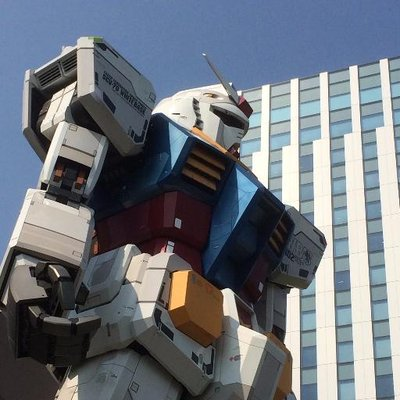

# AIに職は奪われるか？

FORTE@FORTEgp05

本章を執筆したFORTE@FORTEgp05(フォルテ)です。ChatGPTが世間で話題になってから執筆時点でおよそ4年が経ちました。当時から言われている「生成AIに仕事を奪われるんじゃないか？」や「職業がなくなる」という話を書いてみようと思います。

## 奪われる職業もある
結論から書いていますが、生成AIによって多大な影響を受ける職業はあります。こう書くと「じゃあどれが？」とか「どうしたらいい？」を聞きたくなると思いますが、まずはなぜ奪われるのか？を整理してみたいと思います。

### 儲かるから
この文章を見ている多くの人が資本主義、市場主義社会で生活していると思います。誤解を恐れず言えばこの社会はお金を稼ぐ必要があり、また多く稼ぐことが望まれる社会です。

そう考えると人より生成AIがより安価に、より早く、より多くお金が稼げるのなら使わない理由はありません。つまり、生成AIに奪われる職業は存在するということになります。

#### 社会主義国家ではどうか？
職業が奪われる資本主義社会はイヤだ、それなら社会主義国家で暮らしたい！というならそれで良いと思います。では社会主義国家がどうなっているか、ちょっとだけ見てみましょう。

社会主義国家で代表的なのは中国です。名目GDPランキングは世界第2位、生成AI開発においてはアメリカと競っています。そんな中国は1992年から、社会主義市場経済を導入して今日の発展があると言っても過言ではありません。他の国では北朝鮮やソ連が考えられますが、北朝鮮も市場化が進んでいますし、ソ連は35年前に滅びました。

失敗例ばかり挙げてと思われるかもしれませんが、調べても出てこないのです。なお皮肉ではありますが、最も成功した社会主義国家は日本だと言われています。

## 奪われるのはどの職業か
これは明確にこの職業だと挙げるのは未来予測になってしまうので難しいのですが、執筆している2026年11月現在で生成AIの影響が出ていると言われている職業から考えてみます。

### 数学者
「数学界の難問、AIによって証明！」といった見出しのニュースをご覧になった方もいるかもしれません。ここ1年ほどで職業としての数学は生成AIの影響を強く受けたと言われています。

フロンティアモデルと呼ばれる最先端モデルのベンチマークやPRに数学の難問を解くという行為が目立つようになっています。この風潮は若手数学者の職を奪うのではないか？と研究者界隈では問題視され始めています。

また、大学などで博士課程の学生を教えながら研究している研究者が学生を弟子として取ることをやめたという話も出てきています。

### プログラマ
あえてソフトウェアエンジニアではなくプログラマと書きましたが、人から言われたままただプログラミングだけをする人は既に厳しいと感じています。

ビジネスをちゃんと理解してエンジニアリングしている人については、言われたままのプログラマだけより長生きできそうです。しかし既に生成AIの能力は一流のソフトウェアエンジニアを超えているそうです。生成AIのフロンティアモデルを開発しているトップクラスのソフトウェアエンジニアが、来年は自分の仕事を生成AIに奪われると感じているそうでした。

### 生成AIが得意なものは代替される
生成AIが得意、というのは人間より得意という意味になります。つまり先にも挙げた「人より生成AIがより安価に、より早く、より多くお金が稼げる」のであれば使わない理由はありません。まさにそういう職業は生成AIに代替されるでしょう。これは市場原理から言っても当然のこととなります。

数学の研究については24時間365日、膨大な手法を試せる生成AIに人間の研究者が勝つのは難しそうです。プログラマにしてもソフトウェアエンジニアにしても、プログラムやITという文脈ではデジタルの存在である生成AIに勝つのは無理そうです。

もちろん、その中でも人間が得意な部分は残りますが、それがどれくらいの割合なのかは分かりません。生成AIに代替されていないと言い切れるほど残るのか？と言われると怪しいと思っています。

## では、どうするか？
人間より生成AIが稼ぐのが得意ならば、生成AIより人間が稼げる場所で勝負するか、そもそも稼ぐというゲームから降りるしかありません。それぞれの方向性を見てみましょう。

### 生成AIより人間が稼げる場所で勝負
分かりやすいのは身体性が必要とされる職業です。これは単なる肉体労働という意味ではありません。人間がやることに価値があるという意味です。分かりやすいのはスポーツや将棋やチェスなどです。フィジカルAIに代表される機械の体を生成AIが手に入れたとしても、人間が鑑賞するスポーツであれば生身の人間が努力することの価値はなくならないと思います。

将棋なども同じで、たとえ生成AIの方が人間の騎士より強くてもそこに物語がある以上は人間の棋士に対する価値はなくならないでしょう。こういった分野を見つけることで、生成AIと勝負ができるかもしれません。

### 稼ぐゲームから降りる
人間は単純なお金の多寡以外にも価値を見出します。ある絵を見た時に作者は人間と書かれている絵と、作者は生成AIと書かれている絵ではどちらが高い評価がされるか？という実験がありました。結果は人間が書いたと書かれた絵のほうが評価が高かったそうです。たとえ生成AI製の絵に作者は人間と書いても、人間が描いた絵に生成AI製とラベルを付けても、必ず作者は人間というラベルのほうが評価が高かったそうです。

また、別の事例では生成AIのセールスエージェントに商品を営業されるより、わざわざこちらにまで生身の人間が出張ってきてくれて営業される方が、生成AIよりは人間の方が買いたいと思うでしょう。生成AIに子守されたり、介護されるよりは人間に対応されたほうが価値を感じるはずです。

### それができれば苦労しない
自分の職業にこういった特徴があれば生成AIに職を奪われる心配は（当面）なさそうですが、そう言われてじゃあ今からプロスポーツ選手になろう、いまからプロ棋士になろう、人と触れ合う職業に変えようとはならないでしょう。それができればこの章をここまで読んでいないと思います。

他にも生成AIに使われるのではなく使う側になろう！みたいな言説も見かけますし、それは一定までは正しいと思いますが、生成AIを使う側が一生安泰とは限りません。なにせ生成AIを開発している人が来年の職を心配しているありさまです。生成AIの性能が上がれば使われる側になる可能性は十分あります。

実はここまでで誤っている前提がひとつあります。それは、苦労しないという点です。

## 苦労しましょう
大前提なのですが、そもそもこの市場主義社会では多くの人が苦労せずに生きていけるようになっていないのです。多くの人というかほぼすべての人と言い換えても良いかもしれません。生まれながらにしてお金を稼ぐ必要がない境遇にある人以外は、程度の差はあれど苦労しないと生きていけない仕組みになっています。

ここで自分は苦労なんてしたくない、ただ楽して生きていきたいというのならごめんなさい。私がその方法を知りたいくらいなので、説明はできません。ここで紹介するのは正しい苦労の仕方となります。

### お金の稼ぎ方という授業はない
まず冷静になって考えてみてほしいのですが、そもそも学生時代や子供の頃に市場主義社会において価値を発揮する方法や、どうやったらお金を稼ぐことができるか習った記憶はあるでしょうか？少なくとも私が受けた1990年～2000年代初頭の義務教育ではそんなことは教えてくれませんでした。おそらくこの前後20年くらいであれば、そこまで大きく方針が変わっていることはないと思います。

つまり、勉強の仕方は教えてくれても、市場でお金を稼ぐ方法は教えてくれなかったということになります。

### 社会や教育が悪い
そう考えてみるとそういう教育にした社会が悪い、社会の役に立たない教育が悪いとなってしまいそうです。これは半分正解だと思います。実際いまの教育は、現在の社会に適合していません。分かりやすい例はずっと「決められた正解を述べよ」と言われてきたのに社会に出たら「自分の考えを述べよ」と言われるハシゴ外しだと思います。

この原因は単純な話でして、昔の日本にはこの教育によってお金を稼げた時代があったのです。だから、こういう教育をしていました。このすれ違い自体は解決した方が良い話なのですが、すでにこのタイプの教育を受けてしまった人たちが教育が悪いと叫んでも自分にとっては何も意味がありません。

では、正しい苦労とはなにか？というと「考えること」だと思っています。

### 深く真剣に考える
「普段から考えてるよ」という方もいれば「忙しくて考える暇なんてない」という方もいるでしょう。まず普段から考えてるけど、どうしたらいいか分からないという方は無意識に偏見をもっていないでしょうか？たとえば「アメリカで寿司屋を始める」という可能性は考えてみましたか？英語が喋れない？本当に必要なら勉強すればいいだけです。

次に考える暇なんてないという方こそ、考える時間を持つべきです。木こりのジレンマという話があるのですが、ある木こりが錆びた斧で木を切ろうと苦労している時に他人から斧の刃を研いだらどうか？と言われると「木を切るのに忙しくて刃を研ぐ暇がない」と返します。まさにいま「木こりのジレンマ」に陥っていませんか？

### そして苦労しない、日常へ
この話を聞いた多くの人が「普段から考えてるよ」とか「忙しくて考える暇なんてない」という日常に戻っていきます。そして、思い出したころにこう言うのです。「生成AIに職を奪われそうだ」と。

## 意思決定する
ここまで読まれた方はあと一息です。なにも誰しもがアメリカで寿司屋を始める必要はないですし、必ずしも考える時間を確保する必要はありません。それぞれ、自分にあった解決方法でよいのです。ここで最も重要なのはやると決めることです。

「生成AIに職を奪われそうだ」と不安に思うなら、奪われないようにすると決めて今すぐ考え、動きましょう。もう考えてる？不安になるのであれば足りません、もっと考えたり、実際に行動に移して確認してみましょう。時間がない？1日に何をしているかすべて書き出して、減らせそうなものがないか確認して、減らしていきましょう。

意思決定するということはこういうことです。深く真剣に考えるというのはこういうことです。正しく苦労するということはこういうことなのです。

### 生成AIは意思決定できない
生成AIを人間に例えることがよくあるのですが、生成AIと人間には違う点が多くあります。その中で最も大きなものの1つが意思決定できるか？だと思っています。生成AIはインプットがなければ何も出来ません。自律的に動いている生成AI(エージェント)があったとしても、それは誰かが「自律的に動け」とプロンプトを与えたからです。

人間は違います。誰でも意思決定することができ、やるもやらないも自由です。これは生成AIが生成AIである以上は未来永劫ずっと変わらない人間のアドバンテージだと思います。

## 小さく始めて急がず過程を楽しむ
仮に「アメリカで寿司屋を始める」と意思決定しても、無理して明日カリフォルニアに行く必要はありません。まずは1日5分でも英語の勉強をするとか、現在のアメリカで寿司がどれくらい人気か調べてみるとかでもいいのです。

大事なのは「生成AIに職を奪われなかった」という結果ではなく、「生成AIに職を奪われないようにやっていること」こそが重要だと考えています。それがどんなに小さく、またゆっくりとしたものでも何かを意思決定し、深く真剣に考え、やっていることには大きな価値があると思います。

そしてその価値を得る過程を楽しむこと。人生は「生成AIに職を奪われなかった」という結論のためにあるのではありません。そこに至るまでの道のりを楽しむことが人生を送るということなのではないでしょうか。生きるための職を奪われる不安によって、人生まで奪われてしまうのは本末転倒というものです。人生も生成AIに奪われないようにしたいですね。

#### 本章の執筆者

    
    

        

            <b>FORTE（フォルテ）</b>
            <a href="https://twitter.com/FORTEgp05">Twitter@FORTEgp05</a>
        

        

            サークル名：aozora Project
        

    

ソフトウェア開発者ですが、いろいろやってます。Twitter、ブログ、Podcast配信、数多くの趣味と楽しく活動中。
